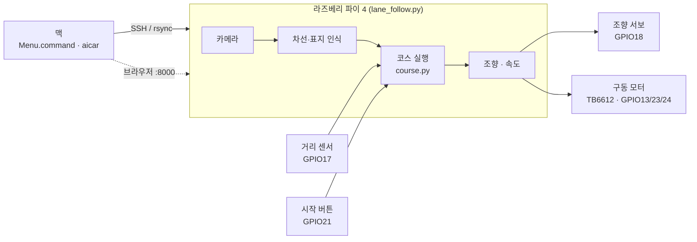

# AICAR — 라즈베리 파이 자율주행 미니카


카메라 한 대로 흰 차선을 따라가고, 교차로·횡단보도·신호등·레고 사람·장애물에 반응하며,
`course.py`에 적은 순서대로 경기 코스를 완주하는 자율주행 RC카입니다.
맥에서 메뉴를 더블클릭하거나 `aicar` 명령 하나로 코드 업로드, 주행, 보정, 녹화 분석을 모두 할 수 있습니다.

---

## 주요 기능

| 분야 | 내용 |
|---|---|
| **차선 주행** | 화면 아래를 여러 띠로 나눠 흰 선을 찾고, 위치·방향 오차로 조향각을 계산 (`bands` / `pairs` / `track` 방식) |
| **코스 실행** | 교차로, 차선 끝, 횡단보도, 차선 끊김을 만날 때마다 `course.py`의 다음 동작 실행 (좌회전, 우회전, 유턴, 정지 등) |
| **인식** | 신호등(빨강/초록), 횡단보도, 레고 사람(TFLite 신경망), 정지 지점, 거리 센서 장애물 |
| **시작 버튼** | GPIO21 버튼: 한 번 누르면 출발 → 일시정지 → 다시 출발, 3초 꾹 누르면 대기 상태로 |
| **출발 전 조향 확인** | 버튼으로 출발할 때 앞바퀴를 왼쪽 → 오른쪽 → 중앙으로 움직여 서보 상태를 확인 |
| **안전 장치** | 모터 감시(루프가 멈추면 정지), 별도 감시 프로세스(프로그램이 죽어도 모터 정지), 맥 연결이 끊겨도 주행 유지 |
| **브라우저 화면** | 주행 중 인식 결과를 `http://<파이 IP>:8000`에서 실시간 확인, 웹에서 신호등·횡단보도·선 등록 |
| **기록과 분석** | 모든 주행의 기록 자동 저장, 녹화 영상을 맥에서 다시 분석(`replay`), 폐루프 시뮬레이터(`sim.py`) |
| **자동 보정** | 경기장에서 트랙 색, 초점, 조명, 차선 폭, 소실점, 카메라 중심을 한 번에 측정·저장 |

## 시스템 구성



## 하드웨어와 배선

| 부품 | 파이 핀 | 비고 |
|---|---|---|
| 조향 서보 신호 | GPIO18 (12번) | 하드웨어 PWM 50Hz |
| 모터 드라이버 TB6612 PWMA | GPIO13 (33번) | 하드웨어 PWM 20kHz |
| TB6612 AIN1 / AIN2 | GPIO23 (16번) / GPIO24 (18번) | 방향 |
| TB6612 STBY, VCC | 3.3V | GND 공통 |
| 거리 센서 Sharp GP2Y0A21 | GPIO17 (11번) | 5V 전원 |
| 시작 버튼 | GPIO21 (40번) ↔ GND (39번) | 내부 풀업 |
| 카메라 | CSI | Picamera2 |

하드웨어 PWM을 쓰려면 `/boot/firmware/config.txt`에 `dtoverlay=pwm-2chan,pin=18,func=2,pin2=13,func2=4`가 필요합니다.
SD 카드 이미지는 [`os-image/`](os-image)의 스크립트로 만듭니다.

## 빠르게 시작하기

1. 맥과 파이를 같은 Wi-Fi에 연결합니다. 파이의 핫스팟(`10.42.0.1`)에 붙어도 됩니다. 주소는 자동으로 찾습니다.
2. **`Menu.command`** 를 더블클릭하면 모든 기능이 한국어 메뉴로 나옵니다.
3. 터미널을 쓴다면:

```bash
./aicar status
```

```bash
./aicar calibrate
```

```bash
./aicar go
```

- `aicar status`: 연결과 파이 상태 확인
- `aicar calibrate`: 경기장에서 한 번 자동 보정 (직선 차로 가운데에 차를 놓고)
- `aicar go`: 주행 시작 (코드를 자동으로 올린 뒤 실행). 버튼을 켜 두었다면 버튼을 눌러야 출발합니다.

멈출 때는 터미널에서 `Ctrl+C`, 다른 창에서 `./aicar stop`, 또는 차의 버튼을 한 번 누릅니다.
전체 명령은 `./aicar help`로 볼 수 있습니다.

## 코스 작성

경기 코스는 [`pi/course.py`](pi/course.py)의 `COURSE` 목록에 순서대로 적습니다.
메뉴의 **자율주행 → 코스 편집**이나 `./aicar course`로 열 수 있고, 저장한 뒤 `./aicar push`(또는 다음 `go`) 때 파이에 올라갑니다.
VS Code를 쓴다면 [`tools/vscode-course`](tools/vscode-course)의 확장을 설치하면 자동 완성과 오류 표시를 쓸 수 있습니다.

```bash
python3 tools/vscode-course/install.py
```

자주 쓰는 스위치 (`course.py` 맨 위):

| 스위치 | 뜻 |
|---|---|
| `SPEED` | 기본 주행 속도 (0~1) |
| `SLOWDOWN_ON` | 교차로 접근·차선 놓침·회전 때 감속 여부 |
| `PERSON_ON`, `PERSON_AT` | 레고 사람 인식과 정지 위치 |
| `LANE_POINTS` | 차선 계산 방식 (`pairs` / `bands`) |

## 폴더 구조

```
AICAR/
├── Menu.command          한국어 메뉴 (더블클릭)
├── Drive.command 등      자주 쓰는 동작 바로 실행
├── aicar                 맥에서 쓰는 명령 도구 (연결, 업로드, 주행, 보정, 녹화)
├── Commands/             분야별 더블클릭 실행 파일 (수동, 자율주행, 카메라, 설정, 시스템)
├── Tune/                 인식 맞추기·보정 실행 파일
├── pi/                   파이에서 실행되는 코드
│   ├── lane_follow.py    주행 프로그램 (인식, 조향, 코스 실행, 브라우저 화면)
│   ├── course.py         경기 코스와 주행 스위치
│   ├── car.py            서보·모터 제어와 모터 안전 장치
│   ├── start_button.py   시작 버튼과 출발 전 조향 확인
│   ├── obstacle.py       거리 센서
│   ├── person.py         레고 사람 인식
│   ├── calibrate.py      자동 보정
│   ├── sim.py            폐루프 주행 시뮬레이터 (맥)
│   └── replay.py         녹화 재분석 (맥)
├── tests/test_vision.py  합성 영상으로 인식·코스·안전 로직 시험 (파이 없이)
├── tools/                녹화 비교, 시뮬레이터 평가, VS Code 코스 도우미
├── os-image/             SD 카드 이미지 만들기
└── cad/                  차체 Fusion 360 파일
```

## 시험

파이 없이 맥에서 인식, 코스 로직, 시작 버튼, 안전 장치를 시험합니다.

```bash
.venv/bin/python tests/test_vision.py
```

시뮬레이터로 여러 트랙을 달려 보고 차선 유지 성능을 비교할 수 있습니다.

```bash
.venv/bin/python pi/sim.py
```

## 안전

- 주행 루프가 0.5초 동안 명령을 보내지 않으면 모터를 멈춥니다.
- 주행 프로그램이 강제로 종료돼도, 따로 도는 감시 프로세스가 2초 안에 모터를 끕니다.
- 맥과의 연결이 끊겨도 주행은 계속됩니다. 이때는 차의 버튼을 눌러 일시정지하거나, 다시 연결해 `./aicar stop`을 실행합니다.
- 비밀번호와 기기별 보정값(`credentials.txt`, `pi/*.json`)은 저장소에 올리지 않습니다.
